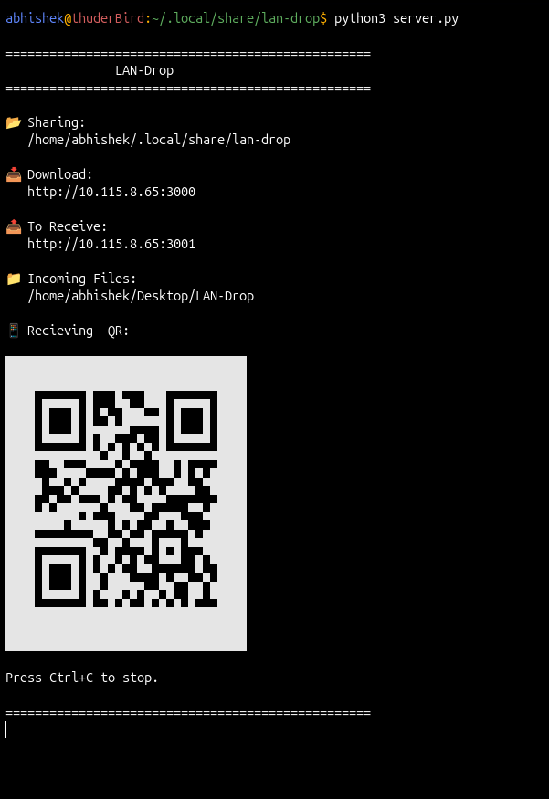
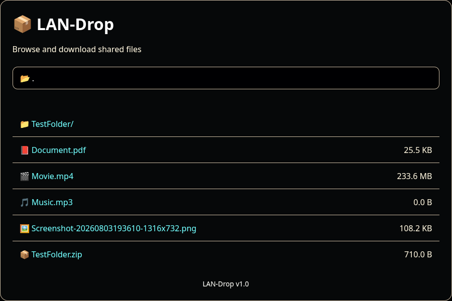
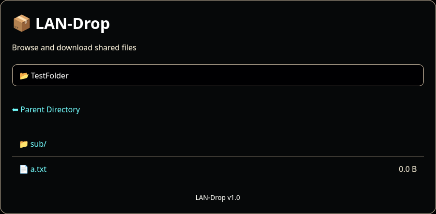
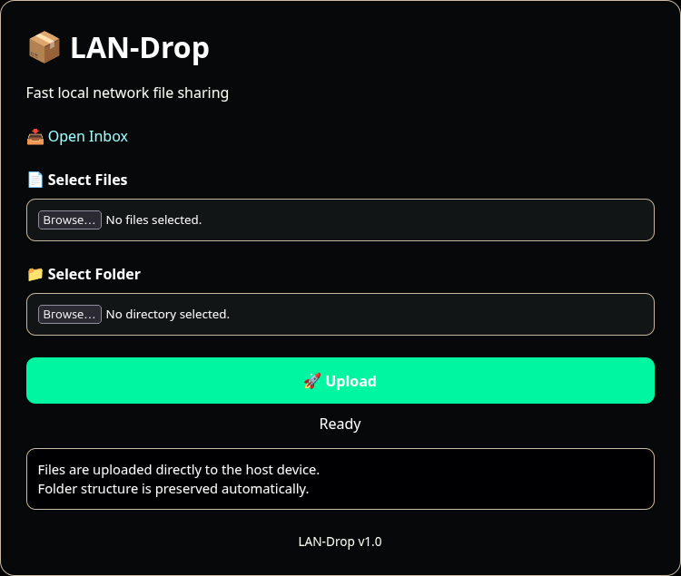
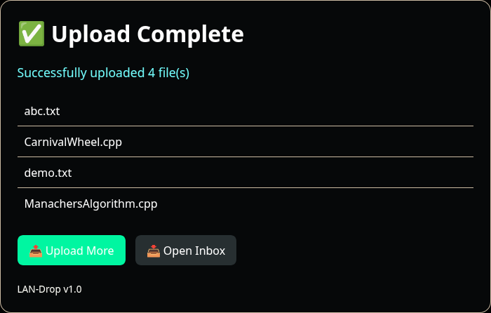
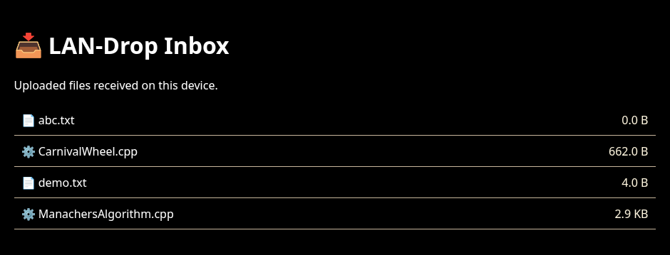

# LAN-Drop

**Lightweight, cross-platform file sharing over your local network.**

LAN-Drop is a Python-based tool that lets devices connected to the same local network upload and download files through a web browser. No accounts, cloud services, or internet connection are required for local file transfers.

- **No required third-party Python dependencies**
- **Two simple web interfaces:** download and upload
- **Tested across multiple platforms**
- **Mobile-friendly and supports large-file uploads**

> **Performance:** Speeds of 50+ Mbps were observed during testing over Wi-Fi 5 with an Android device. Actual performance depends on the network, Wi-Fi signal, hardware, and connected devices.

---

## Features

### File Sharing

- Download files from the host computer.
- Upload files from phones, tablets, and computers.
- Upload multiple files at once.
- Upload entire folders using a compatible browser.
- Preserve folder structure during uploads.
- Handle duplicate filenames without silently overwriting existing files.
- Browse shared directories and view file sizes.
- Save incoming files to a `LAN-Drop` folder on the host user's Desktop.

### Cross-Platform Support

**Host operating systems**
- Linux
- Windows
- macOS

**Client devices**
- Android
- iPhone and iPad
- Linux
- Windows
- macOS

Access LAN-Drop from a modern web browser on a device connected to the same local network.

### User Experience

- Responsive, mobile-friendly interface
- Upload progress bar
- Optional QR code for quick access
- Upload inbox for received files
- Dark, modern UI
- File-size display
- Directory browsing and navigation

### Terminal Logging

LAN-Drop displays useful information about file transfers in the terminal.

Example:

```text
[RECEIVING] movie.mkv from Android (192.168.1.105)
[DOWNLOADED] Linux.iso by Windows PC (192.168.1.121)
```

*Example log messages; the exact format may vary.*

### Large-File Support

LAN-Drop uses a custom streaming multipart implementation to process uploads without intentionally buffering the entire uploaded file in memory.

Tested scenarios include:

- Single-file uploads
- Multiple-file uploads
- Folder uploads
- Large audio files
- Large media files

Actual upload performance and maximum practical file size depend on available storage, memory, network conditions, and the client browser.

---

## Screenshots

### Terminal Startup



### Download Interface





### Upload Interface



### Upload Progress



### Upload Inbox



---

## Requirements

### Software

- Python 3.10 or newer
- A local network connecting the host and client devices
- A modern web browser on each client device

### Python Dependencies

**None required for the core application.**

LAN-Drop uses Python's standard library for its core file-sharing functionality. QR-code generation is optional and depends on an available QR generator.

### Optional QR-Code Support

QR-code support makes it easier to open LAN-Drop on another device.

**Linux — recommended**

```bash
sudo apt install qrencode
```

Alternatively, on Ubuntu or Debian-based distributions:

```bash
sudo apt install python3-qrcode
```

**Windows**

```powershell
python -m pip install qrcode
```

**macOS — recommended**

```bash
brew install qrencode
```

These are optional additions, not mandatory installation steps. If QR generation is unavailable, use the LAN URLs printed in the terminal.

---

## Installation and Setup

### Linux

Clone the repository:

```bash
git clone https://github.com/Abhisheksinghchauhan192/Lan-Drop.git
cd Lan-Drop
```

Start LAN-Drop:

```bash
python3 server.py
```

Optional: install a QR-code generator if you want QR-code support.

```bash
sudo apt install qrencode
```

### Windows

1. Install Python 3.10 or newer from [python.org](https://www.python.org/downloads/).
2. Download or clone the LAN-Drop repository.
3. Open PowerShell or Command Prompt in the folder containing `server.py`.

Start LAN-Drop:

```powershell
python server.py
```

If `python` is not recognized, try:

```powershell
py -3 server.py
```

QR-code generation is optional.

### macOS

Install Python if necessary. With Homebrew:

```bash
brew install python
```

Download or clone the repository, then open a terminal in the project directory.

Start LAN-Drop:

```bash
python3 server.py
```

Optional: install the native QR-code utility:

```bash
brew install qrencode
```

---

## Usage

### 1. Start LAN-Drop

Run the appropriate command for your operating system from the directory containing `server.py`.

**Linux and macOS**

```bash
python3 server.py
```

**Windows**

```powershell
python server.py
```

By default, LAN-Drop shares the current working directory. When you run it from the project directory, this is normally the directory containing `server.py`.

### 2. Share a Custom Directory

You can pass a directory path as an argument to share a different folder.

**Linux**

```bash
python3 server.py "/home/USER/Desktop"
```

**Windows**

```powershell
python server.py "C:\Users\YourName\Downloads"
```

**macOS**

```bash
python3 server.py "$HOME/Downloads"
```

Replace the example paths with the directory you want to share. Keep paths containing spaces inside quotation marks.

### 3. Open the LAN URLs

On startup, LAN-Drop displays the available addresses and the incoming-files directory.

Example:

```text
==================================================
                  LAN-Drop
==================================================

Sharing:
  /home/user/Downloads

Download:
  http://192.168.1.50:3000

Upload:
  http://192.168.1.50:3001

Incoming Files:
  /home/user/Desktop/LAN-Drop
==================================================
```

The addresses above are examples. Use the actual URLs printed by your instance.

- **Port 3000:** browse and download shared files.
- **Port 3001:** upload files to the host.

Open the relevant URL in a browser on another device connected to the same local network. You can also scan the displayed QR code when available.

Press **Ctrl+C** in the host terminal to stop LAN-Drop.

---

## Uploading Files

Open the upload address in a browser:

```text
http://HOST-IP:3001
```

Replace `HOST-IP` with the host computer's LAN IP address.

You can upload a single file, multiple files, or entire folders where supported by the browser.

### Example

Suppose you upload this folder:

```text
Project/
├── main.py
├── notes.txt
└── images/
    └── logo.png
```

The uploaded result retains the folder structure:

```text
LAN-Drop/
└── Project/
    ├── main.py
    ├── notes.txt
    └── images/
        └── logo.png
```

Incoming files are stored in the host's configured upload directory, normally the `LAN-Drop` folder on the Desktop.

**Important:** Keep the upload page open until the upload finishes. Avoid refreshing or closing the page during an active transfer.

---

## Downloading Files

Open the download address in a browser:

```text
http://HOST-IP:3000
```

You can:

- Browse shared directories.
- Navigate into folders.
- View file sizes.
- Download individual files.

The files available for download come from the directory selected for sharing when LAN-Drop starts.

LAN-Drop currently downloads individual files. It does not yet package an entire folder into a ZIP archive for download(intentional Design).

But you can always zip it yourself then share it  😎

---

## Project Structure

```text
Lan-Drop/
├── server.py
├── config.py
├── handlers/
│   ├── download.py
│   └── upload.py
├── templates/
│   ├── download.html
│   └── upload.html
├── utils/
│   ├── file_utils.py
│   ├── network.py
│   ├── qr.py
│   └── templates.py
├── README.md
└── LICENSE
```

The upload destination is configured by the application and may be created at runtime.

---

## Troubleshooting

### Cannot Access LAN-Drop from a Phone or Another Computer

Check the following:

1. Both devices are connected to the same local network.
2. The host computer is running LAN-Drop.
3. You are using the correct LAN IP address printed by the application.
4. Ports `3000` and `3001` are not blocked by the host firewall.
5. Your router or Wi-Fi network does not have client isolation enabled.

On Windows, allow Python through Windows Firewall on your trusted private network if necessary. On Linux, check your firewall rules if the ports are unreachable.

### Upload Fails

- Keep the upload page open until the transfer completes.
- Check that the host has enough free disk space.
- Check the terminal for errors.
- Confirm that the upload destination is writable.
- Try a smaller file to help determine whether the problem is related to file size, storage, or connectivity.

### Folder Upload Not Working

Folder uploads depend on browser support and how the browser exposes file-selection features.

Try a recent version of one of these browsers:

- Chrome
- Microsoft Edge
- Brave
- Opera

### QR Code Missing

QR-code generation is optional. First, check whether a supported QR generator is installed.

**Linux:**

```bash
sudo apt install qrencode
```

**Windows:**

```powershell
python -m pip install qrcode
```

**macOS:**

```bash
brew install qrencode
```

If a QR code is still unavailable, use the download or upload URL printed in the terminal.

---

## Security Notice

LAN-Drop is intended for use on **trusted local networks**.

- Do not expose its ports directly to the public internet.
- Use it only on networks where you trust the connected devices.
- Remember that other reachable devices may be able to access the sharing interfaces.
- Stop the application when you have finished sharing files.

LAN-Drop is designed for simple local file transfers, not as a public-facing file server.

---

## Tips

### Create a Launch Shortcut

You can create a small command-line shortcut so LAN-Drop can be started from any terminal without changing to the project directory first. Replace the repository path in the examples with the absolute path on your computer.

**Linux and macOS**

For Bash or Zsh, add a shell function to `~/.bashrc` or `~/.zshrc`:

```bash
landrop() {
    python3 "/path/to/Lan-Drop/server.py" "$@"
}
```

Reload the shell configuration or open a new terminal, then start LAN-Drop with:

```bash
landrop
landrop "/path/to/folder-to-share"
```

For Fish, add the equivalent function to `~/.config/fish/config.fish`:

```fish
function landrop
    python3 "/path/to/Lan-Drop/server.py" $argv
end
```

**Windows PowerShell**

Create a function in your PowerShell profile:

```powershell
function landrop {
    python "C:\path\to\Lan-Drop\server.py" @args
}
```

After restarting PowerShell, use:

```powershell
landrop
landrop "C:\path\to\folder-to-share"
```

The shortcut passes all additional arguments to `server.py`, so you can still choose a custom shared directory.

## Future Plans

Potential improvements include:

- Drag-and-drop uploads
- Upload speed indicators
- Download progress indicators
- Archive download support
- User-configurable ports
- Improved device-name detection
- Optional authentication

---

## License

Released under the **MIT License**.

See the [`LICENSE`](LICENSE) file for details.

---

## Author

**Abhishek Singh Chauhan**

Built as a practical Python and networking project to make local file sharing simple, fast, and accessible without relying on cloud services.

**Repository:** [GitHub — LAN-Drop](https://github.com/Abhisheksinghchauhan192/Lan-Drop)
